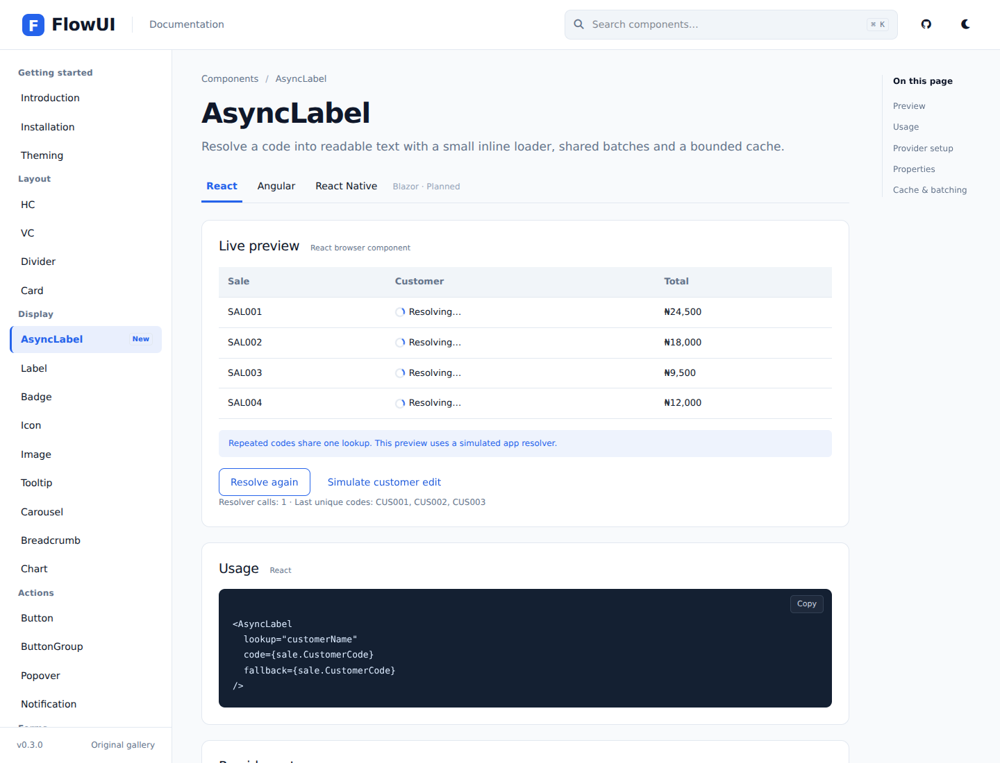
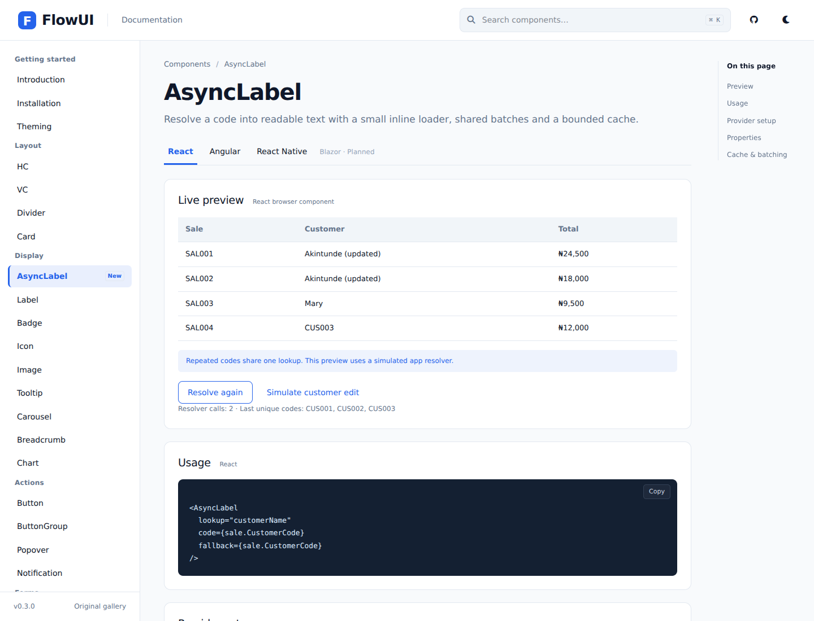
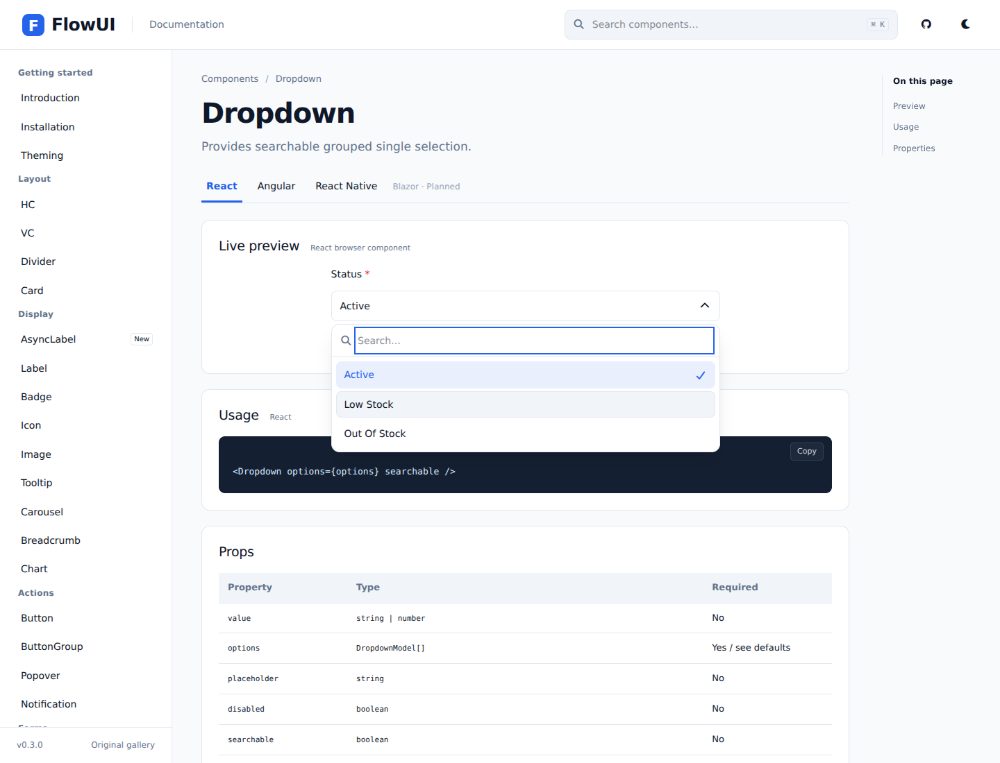
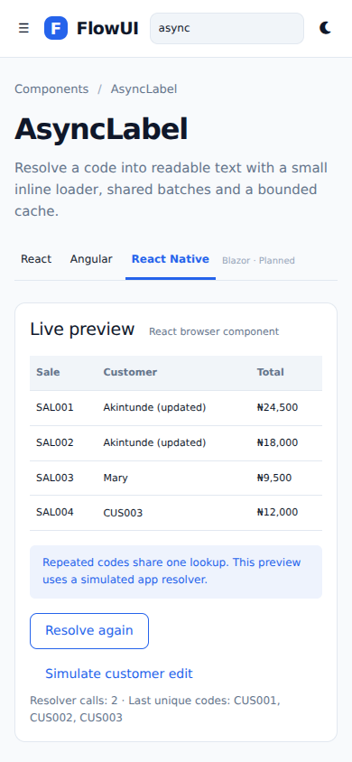
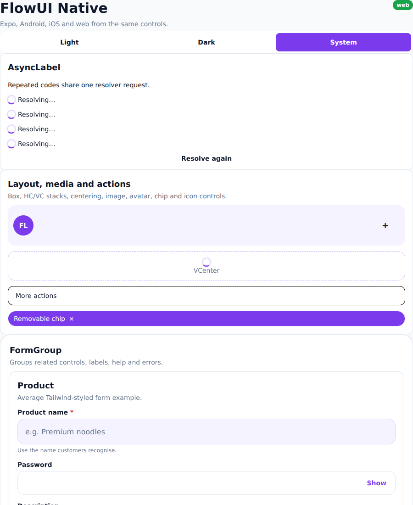

# FlowUI usage image guide

These are screenshots of the implemented documentation, not design mockups.

## Open a component

Run `npm run dev:react` or `npm run dev:angular`. Select a component in the sidebar
or search for it. Its page contains a live preview, framework usage, provider setup
where needed, and a source-generated property reference. React, Angular and React
Native tabs show each adapter's contract. Blazor remains planned.

## Resolving names

A small inline loader appears in each pending cell. The application resolver is
called once for the unique codes in this table; the two CUS001 cells share a result.
The demo uses a simulated backend delay. Register your real app resolver as shown
in the [AsyncLabel guide](ASYNC-LABEL.md).

## Refresh and saved-name updates

“Resolve again” invalidates the lookup and refreshes active labels in one batch.
“Simulate customer edit” primes the saved name and updates both CUS001 cells without
an additional resolver call. CUS003 is explicitly missing and displays its code.

## Dropdown selection and hover

Active is selected with a blue tint and checkmark. Low Stock has a separate neutral
hover treatment, with space between the rows. Selecting it closes the menu and
updates the value. Dropdown display text comes from its datasource.

## Phone layout

The sidebar becomes a menu drawer at narrow widths. Search filters the navigation;
selecting a result closes the drawer. The framework tabs and code examples remain
available on the selected page.

## React Native / Expo

The native adapter uses ActivityIndicator beside native Text. The Expo web gallery
also shows repeated codes and missing-value fallback, with a refresh action.

